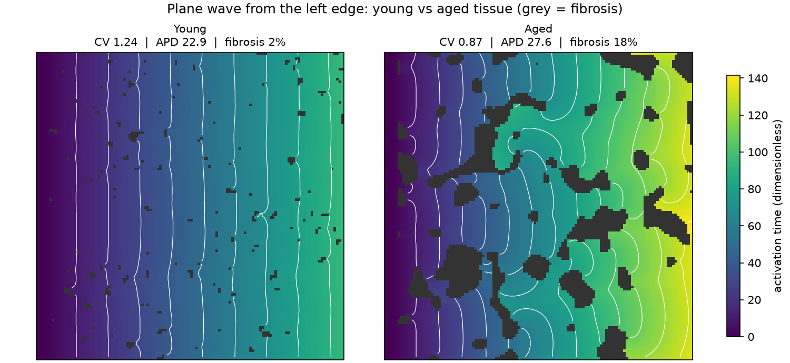
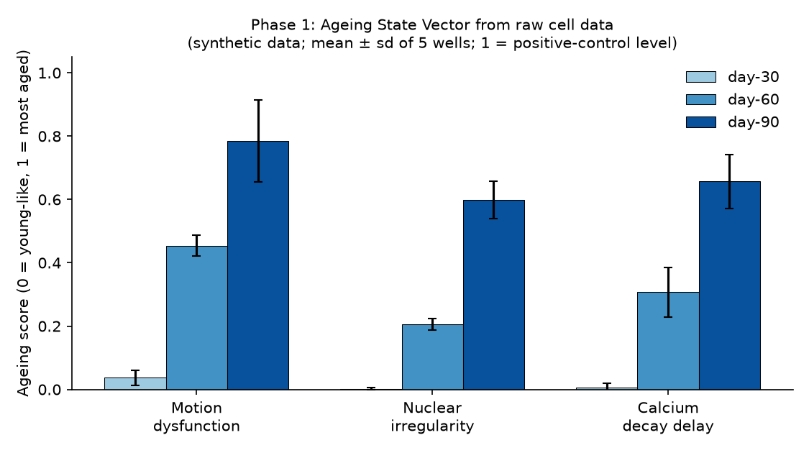
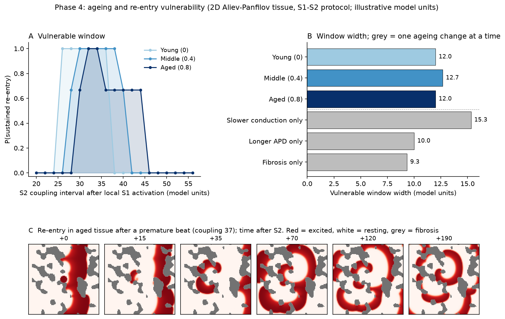
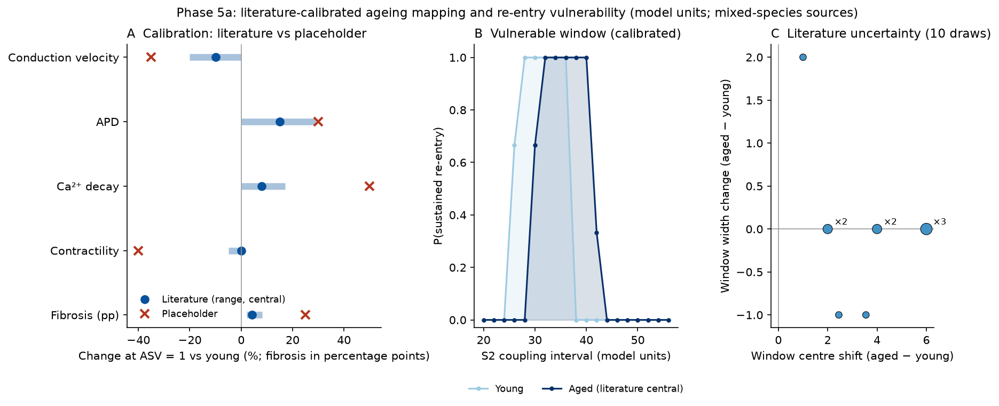
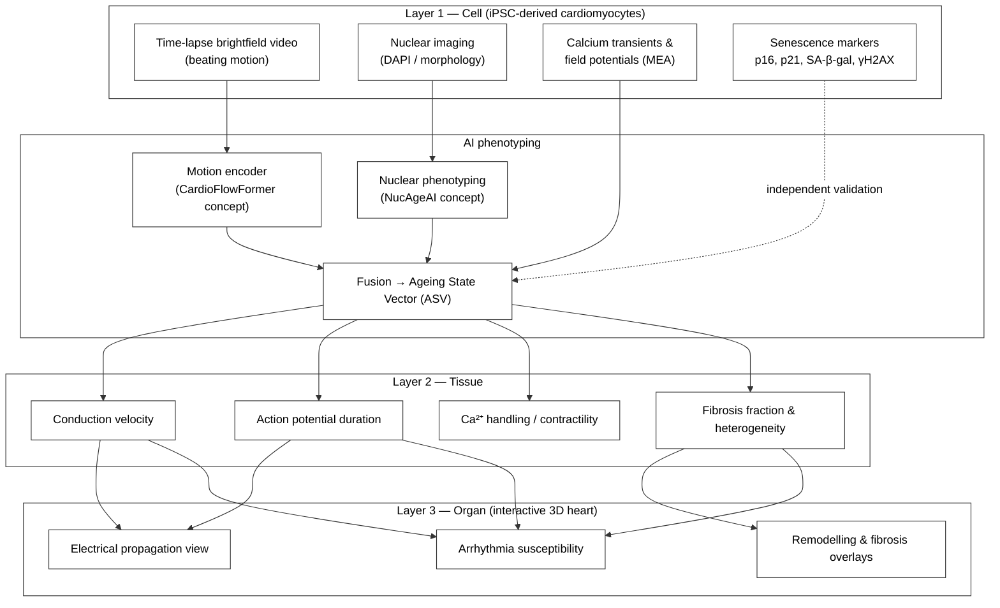

# Cardiac Ageing Digital Twin

[](https://github.com/datascintist-abusufian/Cardiac-Ageing-Digital-Twin/actions/workflows/ci.yml)

**[▶ Open the live 3D heart viewer](https://datascintist-abusufian.github.io/Cardiac-Ageing-Digital-Twin/viewer/)**: move the age / senescence slider and watch conduction slow and fibrosis appear.

> A multiscale digital-twin concept that links **cardiomyocyte ageing**, measured with AI on
> human iPSC-derived cardiomyocytes, to **tissue and whole-heart behaviour**.
> Concept and design by **Md Abu Sufian**, PhD researcher, University of East London
> ([abusufian.dev](https://abusufian.dev)).

---

## Quick start

```bash
git clone https://github.com/datascintist-abusufian/Cardiac-Ageing-Digital-Twin.git
cd Cardiac-Ageing-Digital-Twin
pip install -r requirements.txt
python examples/young_vs_aged.py     # young vs aged simulation + figure
python examples/phase1_pipeline.py   # raw cell data -> ageing scores -> tissue
python examples/reentry_vulnerability.py   # phase 4, about 4 min (--quick for 1 min)
python examples/calibration_uncertainty.py # phase 5a, about 5 min (--quick for 2 min)
pytest -q                            # 24 tests
# 3D viewer: open viewer/index.html through any local web server, e.g.
python -m http.server 8000           # then visit http://localhost:8000/viewer/
```

```python
from cadt import AgeingStateVector, map_to_tissue, simulate

asv = AgeingStateVector(motion_dysfunction=0.7, nuclear_irregularity=0.6, calcium_decay_delay=0.65)
tissue = map_to_tissue(asv)          # ageing scores -> tissue parameters
result = simulate(tissue)            # 2D tissue simulation
print(result["metrics"])             # conduction velocity, APD, activation time, ...
```

### First result: young vs aged tissue



| Measure (illustrative example) | Young | Aged | Change |
|---|---|---|---|
| Conduction velocity | 1.24 | 0.87 | −30% |
| Action potential duration | 22.9 | 27.6 | +21% |
| Time to activate the whole tissue | 95.1 | 141.5 | +49% |
| Fibrosis | 2% | 18% | — |

Units are dimensionless. The aged scores come from `examples/aged_state_example.json` and are
**illustrative, not measured**. The mapping weights are placeholder assumptions until
calibrated (roadmap phase 5).

### Phase 1 result: ageing scores from raw cell data



The phase-1 pipeline turns three kinds of raw recording into the three ageing scores:

| Recording | Features measured | Ageing score |
|---|---|---|
| Brightfield beating video | rhythm irregularity, contraction / relaxation speed, beat-to-beat amplitude variation | `motion_dysfunction` |
| Segmented nuclei (e.g. DAPI) | nuclear size and size spread, circularity, solidity | `nuclear_irregularity` |
| Calcium fluorescence trace | decay time constant (tau), time to 50 % decay | `calcium_decay_delay` |

Each score places a condition between a **young reference** (0) and an **aged positive
control** such as induced-senescence wells (1). Every score can be traced back to per-feature
z-scores (`outputs/phase1_report.json`). Senescence markers are never used to build the
scores, so they stay available as an independent check.

The figure uses **synthetic recordings** (`cadt/synthetic.py`) so the whole pipeline runs
without data. The extractors are classical, transparent baselines; learned models
(CardioFlowFormer for motion, NucAgeAI for nuclei) can replace them as long as they return
the same feature names.

### Phase 3: interactive 3D heart viewer

**[Open the live viewer](https://datascintist-abusufian.github.io/Cardiac-Ageing-Digital-Twin/viewer/)** (runs in the browser, nothing to install).

- **Age / senescence slider**, or set the three ageing scores separately.
- **Load pipeline output**: reads `outputs/phase1_aged_state.json` written by the phase-1 pipeline; **Open JSON…** loads any ageing-state file.
- **Beating** view: the activation wave spreads from apical sites, routes around fibrosis (grey), and the heart contracts; relaxation slows as calcium decay slows.
- **Activation map** view: colour shows when each point is activated; compare young and aged at the same scale.
- Live tables of tissue parameters and whole-heart results (total activation time, effective conduction, APD, fibrotic surface).
- Shareable states through the URL, e.g. [`?age=0.8&mode=map`](https://datascintist-abusufian.github.io/Cardiac-Ageing-Digital-Twin/viewer/?age=0.8&mode=map).

The viewer uses the same mapping rules as `cadt/mapping.py`; a test (`tests/test_viewer.py`) fails if
the two copies ever differ. The geometry is a generic, simplified biventricular shape, not
patient-specific.

### Phase 4: does ageing make tissue more vulnerable to re-entry?



**Protocol.** A plane wave (S1) crosses 2D tissue; a premature beat (S2) is delivered at the
centre a set time after the S1 wave passes. If S2 lands in the recovering tail of S1, it can
block in one direction and curl into a self-sustaining rotor, the basic mechanism of
re-entrant arrhythmias such as atrial fibrillation. The **vulnerable window** is the range of
S2 timings that start sustained re-entry (still active 200 time units later; checked to 500).
Each condition is repeated over 3 fibrosis layouts.

**What the model shows (current placeholder weights):**

| Condition | Window width | Window range | Wavelength (CV × APD) |
|---|---|---|---|
| Young (0) | 12.0 | 26–36 | 28.4 |
| Aged (0.8) | 12.0 | 30–44 | 25.4 |
| Slower conduction only | 15.3 | 24–38 | 20.4 |
| Longer APD only | 10.0 | 32–40 | 35.2 |
| Fibrosis only | 9.3 | 26–38 | 28.4 |

- Ageing **shifts the window later** (centre about +5.6 units), because aged tissue stays
  refractory longer, but with the current weights the overall **width does not change** (12 → 12).
- That is because the ageing changes **pull in opposite directions**: slower conduction widens
  the window (+28 %, shorter wavelength), while longer APD (−17 %) and fibrosis (−22 %) narrow it.
- So whether ageing raises re-entry risk depends on the **balance** between conduction slowing
  and APD prolongation, which is exactly what calibrating the mapping on real data (phase 5)
  has to pin down. The model makes that question explicit and testable.

Caveats: 2D monolayer, two-variable Aliev–Panfilov model, fibrosis represented only as
non-conducting obstacles (no fibroblast coupling), window resolution of 2 units. Mechanistic,
not a clinical risk estimate.

### Phase 5a: calibrating the ageing mapping to published data



The placeholder rules used in phases 0–4 only had plausible *directions*. Phase 5a anchors
each tissue parameter to published young-vs-old measurements, so that an ageing score of 1
(the aged positive-control level) reproduces the change seen in old animals, with a
literature **range** instead of a single number (`cadt/calibration.py`).

| Parameter (old vs young) | Literature value used | Range | Placeholder at ASV = 1 | Evidence |
|---|---|---|---|---|
| Conduction velocity | −10 % | 0 to −20 % | −35 % | Rabbit LV: transverse CV 0.348 → 0.280 m/s (−20 %), longitudinal not slowed [1] |
| Action potential duration | +15 % | 0 to +29 % | +30 % | Rat myocytes APD90 +29 % [2]; rabbit LV APD unchanged (210 vs 206 ms) [1] |
| Ca²⁺ transient decay | +8 % | 0 to +17 % | +50 % | Rat LV τ 71–73 → 74–84 ms [3]; aged mouse decay not affected [4] |
| Contractility | 0 % | 0 to −5 % | −40 % | Mouse cell shortening similar [5]; rabbit EF 65 % vs 64 % [1] |
| Interstitial fibrosis | 2.8 % → 7.0 % | 5–11 % | 2 % → 27 % | Rabbit LV + septum interstitial 2.82 → 6.97 %, total 5.60 → 11.01 % [1] |

The literature is clear that **ageing changes conduction, APD and calcium handling much less,
and resting contractility hardly at all, compared with the placeholder assumptions**.
Fibrosis patchiness has no quantitative source and keeps its placeholder rule.

**Re-entry with the calibrated mapping** (phase-4 protocol; 10 draws with every parameter
sampled from its literature range):

- The vulnerable window **shifts later in all 10 draws** (by 1 to 6 model units, median 3.8):
  aged tissue needs a later premature beat to start re-entry.
- The window **width does not change** reliably (median 0; range −1 to +2, about the
  resolution of the scan).
- So, with literature-sized ageing changes, this 2D model predicts that ageing **moves** the
  window rather than **opening** it. It does not, on its own, reproduce the higher VF
  inducibility seen in old rabbit hearts (7/9 vs 3/12 [1]). That points to mechanisms the
  model leaves out, such as conduction anisotropy (the transverse-only slowing in [1]),
  Purkinje remodelling and fibroblast coupling, which are natural next steps.

The live 3D viewer now uses the literature-calibrated mapping by default (switch back to the
placeholder from the *Mapping* menu, or with `?rules=placeholder`).

**References**

1. Cooper LL, Odening KE, et al. Electromechanical and structural alterations in the aging rabbit heart and aorta. *Am J Physiol Heart Circ Physiol* 2012;302:H1625–35. [doi:10.1152/ajpheart.00960.2011](https://doi.org/10.1152/ajpheart.00960.2011)
2. Howlett LA. *The age-related reduction in adrenergic response as a limitation of cardiac function in old age.* PhD thesis, University of Leeds, 2022. [etheses.whiterose.ac.uk/32273](https://etheses.whiterose.ac.uk/32273/)
3. Intracellular Ca²⁺ decline in aged and adult rat hearts. *Am J Physiol Heart Circ Physiol* 2009;297(5):H1594–H1605. [doi:10.1152/ajpheart.00579.2009](https://doi.org/10.1152/ajpheart.00579.2009)
4. Ca²⁺ transients in adult vs aged mouse ventricular myocytes. *J Physiol* 2017;595(12):3721–3742. [doi:10.1113/JP274134](https://doi.org/10.1113/JP274134)
5. Ageing in C57BL/6 mouse ventricular myocytes. *Sci Rep* 2020;10:10052. [doi:10.1038/s41598-020-66903-z](https://doi.org/10.1038/s41598-020-66903-z)

Caveats: mixed species (rabbit, rat, mouse), tissues and methods; values describe old animals,
not iPSC-derived cardiomyocytes; ranges are the spread between studies, not formal confidence
intervals.

### Repository layout

| Path | What it does |
|---|---|
| `cadt/ageing_state.py` | Ageing State Vector: validation, JSON load / save (`ageing-state/v0.1`) |
| `cadt/mapping.py` | Rule-based ageing → tissue mapping, with Monte Carlo uncertainty |
| `cadt/tissue_sim.py` | 2D Aliev–Panfilov tissue model with patchy fibrosis |
| `cadt/motion.py` | Beating-video features: rhythm, amplitude, contraction / relaxation speed |
| `cadt/nuclei.py` | Nuclear morphology from segmentation masks |
| `cadt/calcium.py` | Calcium-transient decay (tau, CD50) |
| `cadt/scoring.py` | Features → Ageing State Vector (young reference + positive-control anchor) |
| `cadt/calibration.py` | Literature table with references, calibrated rule set, sampling within literature ranges |
| `cadt/reentry.py` | S1–S2 premature-beat protocol, sustained re-entry detection, vulnerable window |
| `cadt/synthetic.py` | Synthetic videos, nuclei and calcium traces for demos and tests |
| `examples/young_vs_aged.py` | Ageing scores → tissue → simulation demo |
| `examples/phase1_pipeline.py` | Raw cell data → features → ageing scores → tissue → simulation |
| `examples/calibration_uncertainty.py` | Phase 5a: calibrated mapping and re-entry under literature uncertainty |
| `examples/reentry_vulnerability.py` | Phase 4 experiment: vulnerable window by ageing level and by single ageing change |
| `viewer/index.html` | Interactive 3D heart viewer (three.js), live on GitHub Pages |
| `tests/` | 24 tests: feature recovery, directions of change, bounds, JSON round-trip, simulation, viewer rules, re-entry, calibration |

---

## 1. Motivation

Most heart digital twins and teaching models show an *adult, healthy* heart, plus a set of
arrhythmias such as atrial fibrillation (AF) and ventricular tachycardia (VT). Many of these
rhythm problems get more common with age, but standard models do not show **why**: the
cell-level changes that build up over decades and slowly change how the whole organ
conducts, contracts and fails.

This project builds a **cellular-ageing digital twin**: a multiscale model where an *ageing
state* measured or predicted at the level of single cardiomyocytes is carried up through
tissue properties into an interactive 3D heart.

**Core question:** *If we know how old and how senescent a population of cardiomyocytes
behaves, what should the heart built from them look like, conduct like and beat like?*

---

## 2. Multiscale architecture



### Layer 1 — Cell
Human iPSC-derived cardiomyocytes (iPSC-CMs) imaged over time give a longitudinal view of
cellular ageing. Ageing can be modelled in vitro through long-term culture, induced
senescence (e.g. doxorubicin or irradiation) or progeroid models. Each readout is a
*phenotype*, not a label: the goal is to measure how cells behave, not just to tag them
"young" or "old".

### AI phenotyping → Ageing State Vector
Two model families turn raw images into numbers:

| Input | Model concept | What it extracts |
|---|---|---|
| Beating-motion video | **CardioFlowFormer** — spatiotemporal Transformer over optical-flow / motion signatures | Beat rate variability, contraction / relaxation velocity, synchrony, irregular beating |
| Nuclear images | **NucAgeAI** — hierarchy-aware nuclear phenotyping | Nuclear size, shape irregularity, texture / chromatin features, phenotype clusters |
| Ca²⁺ / MEA traces | Signal features (classical or learned) | Transient decay time, APD / field-potential duration proxies |

These are fused into an **Ageing State Vector (ASV)**: a small, interpretable set of
continuous scores. Senescence markers are kept **out of training** and used as an
*independent* check, so the twin is not just learning to copy a stain.

### Layer 2 — Tissue
The ASV is mapped onto tissue-level parameters that are known to shift with cardiac ageing:

| Tissue parameter | Typical direction with ageing | Main cellular driver |
|---|---|---|
| Conduction velocity | ↓ | Reduced / lateralised connexin-43, more fibrosis |
| Action potential duration | ↑ | Changes in repolarising K⁺ currents and Ca²⁺ handling |
| Ca²⁺ transient decay | Slower | Reduced SERCA2a activity |
| Contractile reserve | ↓ | Altered Ca²⁺ cycling, myocyte loss / hypertrophy |
| Fibrosis fraction & patchiness | ↑ | Fibroblast activation, collagen build-up |

The first version uses a **transparent, rule-based mapping** (documented coefficients, with
ranges taken from the literature). A learned mapping is only added once paired cell and
tissue data exist.

### Layer 3 — Organ (interactive 3D heart)
Tissue parameters drive an interactive 3D heart model (planned: a Python / web viewer, with an
option to export to a game engine for teaching). Ageing is shown through a small set of
organ-level controls: propagation speed of the activation wave, repolarisation timing,
regional remodelling, and fibrosis overlays. A learner or researcher can:

- move an **"age / senescence" slider** and watch conduction slow down and fibrotic patches appear;
- compare a *young* heart and an *aged* heart side by side running the same rhythm;
- see why aged tissue is more prone to **atrial fibrillation** and re-entry.

---

## 3. Interface contract (proposal)

A simple JSON file links the AI pipeline (Python) to the 3D organ viewer, so the two can be
developed separately:

```json
{
  "schema": "ageing-state/v0.1",
  "source": "iPSC-CM imaging",
  "timepoint_days": 60,
  "ageing_state_vector": {
    "motion_dysfunction": 0.42,
    "nuclear_irregularity": 0.37,
    "calcium_decay_delay": 0.30,
    "senescence_confidence": 0.55
  },
  "tissue_parameters": {
    "conduction_velocity_scale": 0.80,
    "apd_scale": 1.15,
    "fibrosis_fraction": 0.12,
    "fibrosis_heterogeneity": 0.40
  },
  "uncertainty": { "method": "ensemble", "ci95_width": 0.10 }
}
```

*All numbers above are illustrative placeholders, not results.*

The organ viewer reads this file and sets its matching visual and simulation parameters.

---

## 4. Validation plan

1. **Cell level:** ASV scores should go up with culture time and with induced senescence, and
   should agree with senescence markers that the models never saw during training.
2. **Tissue level:** predicted conduction / APD changes are checked against MEA or optical
   mapping data from the same cell lines, where available.
3. **Organ level (teaching):** clinicians and educators review whether the "aged heart"
   view matches textbook and clinical understanding of the ageing heart.
4. **Explainability:** every ASV score can be traced back to example cells / frames
   (attention maps, saliency, nearest-neighbour examples), so it is not a black box.

---

## 5. Known limitations

- **iPSC-CMs are immature** (closer to fetal than adult cardiomyocytes); in-vitro ageing is
  a model of ageing, not the real thing.
- Moving from a 2D cell culture to a 3D organ needs assumptions; the mapping in Layer 2 is a
  hypothesis to be tested, not an established law.
- The organ twin stays **generic**, not patient-specific, unless imaging data such as cardiac
  MRI are added later.
- **For education and research only — not for clinical use.**

---

## 6. Roadmap

| Phase | Goal | Status |
|---|---|---|
| 0 | This concept document; agree the JSON interface | ✅ Done |
| 1 | Python pipeline producing an ASV from iPSC-CM motion + nuclear images | 🟡 Classical pipeline done on synthetic data; real recordings and learned models next |
| 2 | Rule-based ASV → tissue parameter mapping with literature ranges | ✅ First version (placeholder weights) |
| 3 | Interactive 3D heart viewer with an "age / senescence" slider driven by the JSON file | ✅ [Live viewer](https://datascintist-abusufian.github.io/Cardiac-Ageing-Digital-Twin/viewer/) |
| 4 | Young-vs-aged comparison view with AF / VT re-entry scenarios | ✅ S1–S2 re-entry vulnerability with per-change decomposition |
| 5a | Calibrate the mapping to published young-vs-old data, with uncertainty | ✅ Literature-calibrated mapping (5 parameters, 5 sources) |
| 5b | Validation against held-out senescence markers and electrophysiology data from real iPSC-CM recordings | ⏳ Needs data |
| 6 | Optional: patient-specific geometry from cardiac MRI segmentation | ⏳ Planned |

---

## 7. Author

**Concept and design:** Md Abu Sufian, PhD researcher, University of East London
([abusufian.dev](https://abusufian.dev))

---

© 2026 Md Abu Sufian. All rights reserved.
